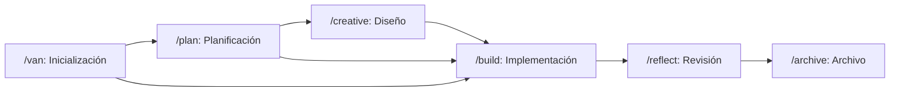

# Memory Bank System v0.8 (`cursor-memory-bank`)

Sistema jerárquico de gestión de tareas y memoria persistente optimizado en consumo de tokens. Opera mediante **seis fases/comandos especializados** interconectados y un directorio compartido `memory-bank/` en la raíz del proyecto.

---

## Arquitectura del Flujo de Trabajo

### Los 6 Comandos del Sistema

| Comando | Definición | Propósito |
|---------|------------|-----------|
| **`/van`** | `.cursor/commands/van.md` | Inicializa el proyecto, detecta plataforma, verifica `memory-bank/` y determina el nivel de complejidad (Nivel 1 a 4). |
| **`/plan`** | `.cursor/commands/plan.md` | Crea planes de implementación detallados según el nivel de complejidad y detecta componentes que requieren fase creativa. |
| **`/creative`** | `.cursor/commands/creative.md` | Explora opciones de diseño (Arquitectura, UI/UX, Algoritmos) usando comparación tabular y registra decisiones en `memory-bank/creative/`. |
| **`/build`** | `.cursor/commands/build.md` | Implementa los cambios planificados de forma secuencial y guiada por tests (TDD gate por fase). |
| **`/reflect`** | `.cursor/commands/reflect.md` | Evalúa la implementación completada frente al plan original y documenta lecciones aprendidas en `memory-bank/reflection/`. |
| **`/archive`** | `.cursor/commands/archive.md` | Consolida la documentación final en `memory-bank/archive/`, marca la tarea como completada y reinicia `activeContext.md`. |

---

## Estructura de Archivos de `memory-bank/`

Todos los comandos leen y actualizan los archivos en `memory-bank/` (en la raíz del proyecto):

- `memory-bank/projectbrief.md` — Fundamentos, objetivos y alcance central del proyecto.
- `memory-bank/productContext.md` — Contexto funcional, usuarios y reglas de negocio.
- `memory-bank/systemPatterns.md` — Arquitectura, patrones de diseño y decisiones técnicas clave.
- `memory-bank/techContext.md` — Stack tecnológico, dependencias, configuración y restricciones.
- `memory-bank/activeContext.md` — Foco actual de trabajo, estado de la sesión y próximos pasos.
- `memory-bank/progress.md` — Historial de hitos completados, estado del build y métricas de avance.
- `memory-bank/tasks.md` — **Fuente única de verdad (Single Source of Truth)** para el seguimiento de la tarea activa, checklists y nivel de complejidad.
- `memory-bank/creative/` — Documentos de exploración de decisiones de diseño (`creative-[feature].md`).
- `memory-bank/reflection/` — Documentos de retrospectiva técnica (`reflection-[task_id].md`).
- `memory-bank/archive/` — Historial archivado de tareas finalizadas (`archive-[task_id].md`).

---

## Niveles de Complejidad (Escala Adaptativa 1–4)

1. **Nivel 1 — Quick Bug Fix:** Correcciones puntuales o ajustes menores. Flujo rápido: `/van` → `/build` → `/archive`.
2. **Nivel 2 — Simple Enhancement:** Mejoras acotadas en uno o pocos componentes. Flujo: `/van` → `/plan` → `/build` → `/reflect` → `/archive`.
3. **Nivel 3 — Intermediate Feature:** Nuevas funcionalidades que cruzan múltiples módulos o requieren decisiones de UI/UX/datos. Flujo completo: `/van` → `/plan` → `/creative` → `/build` → `/reflect` → `/archive`.
4. **Nivel 4 — Complex System / Architecture:** Cambios estructurales o subsistemas completos con implementación por fases. Flujo completo con reglas de `Level4/`.

---

## Carga Jerárquica de Reglas (`Progressive Rule Loading`)

Para optimizar la ventana de contexto, carga únicamente las reglas requeridas por la fase activa desde `.cursor/rules/isolation_rules/` (también espejadas dentro de esta skill en `rules/isolation_rules/`):

1. **Reglas Core (Siempre requeridas al iniciar fase):**
   - `.cursor/rules/isolation_rules/main.mdc`
   - `.cursor/rules/isolation_rules/Core/memory-bank-paths.mdc`
   - `.cursor/rules/isolation_rules/Core/platform-awareness.mdc`
   - `.cursor/rules/isolation_rules/Core/file-verification.mdc`
2. **Mapas Visuales de Modo (`visual-maps/`):**
   - `van_mode_split/van-mode-map.mdc`, `plan-mode-map.mdc`, `creative-mode-map.mdc`, `build-mode-map.mdc`, `reflect-mode-map.mdc`, `archive-mode-map.mdc`
3. **Reglas por Nivel (`Level1/` a `Level4/`) y Fase Creativa (`Phases/CreativePhase/`):**
   - Cargar bajo demanda según el nivel determinado en `memory-bank/tasks.md`.
